<a id="top" name="top"></a>

<h1 align="center">SetGRPO: Calibrating Grader-Induced Policy Optimization</h1>

<p align="center">
  <a href="https://arcadiadream.github.io/HJL.github.io/">Jiale Huang</a><sup>1</sup> &nbsp;·&nbsp;
  <a href="https://lee-zixu.github.io/">Zixu Li</a><sup>1,†</sup> &nbsp;·&nbsp;
  <a href="https://zivchen-ty.github.io/">Zhiwei Chen</a><sup>1</sup> &nbsp;·&nbsp;
  <a href="https://zhihfu.github.io/">Zhiheng Fu</a><sup>1</sup> &nbsp;·&nbsp;
  <a href="https://jinhe-bi.github.io/">Jinhe Bi</a><sup>2</sup> &nbsp;·&nbsp;
  <a href="https://faculty.sdu.edu.cn/huyupeng1/zh_CN/index.htm">Yupeng Hu</a><sup>1,*</sup>
</p>

<p align="center">
  <sup>1</sup>Shandong University &nbsp;&nbsp; <sup>2</sup>National University of Singapore<br>
  <sup>†</sup>Project Leader &nbsp;&nbsp; <sup>*</sup>Corresponding Author
</p>

<p align="center">
  <b>Official Implementation</b>: a set-valued framework for rubric-based GRPO that calibrates grader-induced
  coefficient shifts into a joint uncertainty set with risk-controlled updates.
</p>

<p align="center">
  <a href="https://arxiv.org/abs/2610.36807"></a>
  <a href="https://arcadiadream.github.io/SetGRPO.github.io/"></a>
  <a href="https://www.python.org/"></a>
  <a href="https://pytorch.org/"></a>
  <a href="LICENSE"></a>
  <!-- Stars 徽章：定稿公开后换成最终仓库地址再启用
  <a href="https://github.com/ArcadiaDream/REPO/stargazers"></a>
  -->
</p>

---

## 📑 Table of Contents

- [📌 Introduction](#-introduction)
- [📢 News](#-news)
- [✨ Key Features](#-key-features)
- [🏗️ Architecture](#️-architecture)
- [📊 Experiment Results](#-experiment-results)
  - [Main results](#main-results)
  - [Same-backbone comparison](#same-backbone-comparison)
  - [Training dynamics](#training-dynamics)
  - [Risk calibration](#risk-calibration)
  - [Ablation](#ablation)
  - [Efficiency](#efficiency)
- [📂 Repository Structure](#-repository-structure)
- [🚀 Installation](#-installation)
- [📂 Data Preparation](#-data-preparation)
  - [Training prompts with rubrics](#training-prompts-with-rubrics)
  - [A grading endpoint](#a-grading-endpoint)
  - [A local model checkpoint](#a-local-model-checkpoint)
- [🏃 Quick Start](#-quick-start)
  - [1. Training the model](#1-training-the-model)
  - [2. Run the offline certificate](#2-run-the-offline-certificate)
  - [3. Freeze a calibration rule](#3-freeze-a-calibration-rule)
- [📦 What Is Not Shipped](#-what-is-not-shipped)
- [🤝 Acknowledgements](#-acknowledgements)
- [✉️ Contact](#️-contact)
- [📝 Citation](#-citation)
- [🔗 Related Projects](#-related-projects)
- [🫡 Support & Contributing](#-support--contributing)
- [📄 License](#-license)

## 📌 Introduction

Rubric-based reinforcement learning trains large language models on open-ended tasks through fine-grained grader
feedback, but the grader itself is stochastic. Because GRPO normalizes rewards within each response group and then
combines the resulting training coefficients with response-level gradients, a single scoring discrepancy can shift the
coefficients of the entire group, and the same coefficient shift can produce a different update direction under a
different policy snapshot. Score discrepancies alone therefore do not describe what the optimizer actually does.

**SetGRPO** keeps the original GRPO objective and treats the within-group training coefficients as a *joint uncertainty
set* instead of a point estimate. It calibrates that set conformally, maps it through the current policy's local update
geometry to recover the largest safe update, and admits a response group only when a globally calibrated threshold
keeps the direction-reversal risk under control. Under exchangeability the construction gives finite-sample marginal
coverage for the joint coefficient set and simultaneous risk control across candidate thresholds.

On ten open-ended benchmarks across three domains (Medical, Writing, Instruction Following), **SetGRPO** attains the
highest macro average among all compared training methods on both the Qwen3.5 and Llama3.2 model families.

<p align="center">
  
  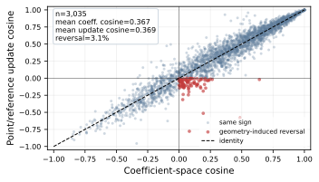
</p>
<p align="center">
  <b>Figure 1.</b> (a) Score disagreement propagates jointly through within-group normalization.
  (b) Policy geometry changes local update alignment.
</p>
<p align="left"><a href="#top"><b>⬆ Back to top</b></a></p>

## 📢 News

Paper first, code second — the release notes below are in reverse chronological order.

- **[2026-10-29]** 🚀 We release the training code, preflight tooling, and the Verl/FSDP recipe of SetGRPO.
- **[2026-10-27]** 📄 SetGRPO is available on arXiv: [arXiv:2610.36807](https://arxiv.org/abs/2610.36807).
<p align="left"><a href="#top"><b>⬆ Back to top</b></a></p>

## ✨ Key Features

Our framework introduces three core modules to absorb the coefficient uncertainty induced by a stochastic grader and
to keep the policy update direction safe:

- 🔍 **Joint Reward Set Calibration** — builds a joint coefficient uncertainty set from paired reward observations,
  with a split-conformal radius that carries finite-sample marginal coverage.
- 🔗 **Geometry-Guided Safe Recovery** — maps candidate coefficients into the current policy's local update geometry
  and returns the largest recovery ratio that keeps the update aligned with the reference direction.
- 🧩 **Selective Risk-Gated Optimization** — selects a single global threshold on an independent risk-calibration set,
  bounding the conditional direction-reversal risk of the updates that survive the gate, while preserving the original
  GRPO objective.
- 🏆 **Consistent gains across backbones** — same-backbone comparison against RubricHub gives **57.56** macro average on
  Qwen3-4B (+1.50) and **60.59** on Qwen3-14B (+1.47), with the joint set and the threshold calibrated separately per
  backbone.
<p align="left"><a href="#top"><b>⬆ Back to top</b></a></p>

## 🏗️ Architecture

The three modules run in sequence on every training step: the coefficient set is calibrated from paired grader scores,
each candidate is projected onto the current policy's update geometry, and only the groups that pass the risk gate
contribute to the GRPO objective.

<p align="center">
  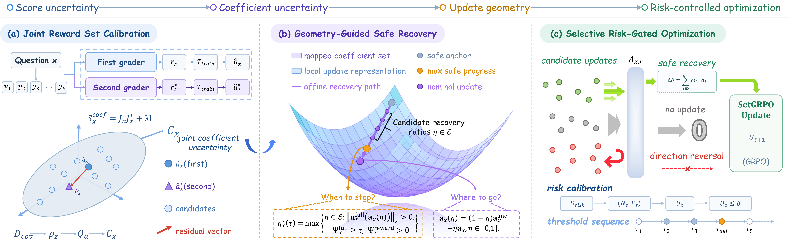
</p>

<p align="center">
  <b>Figure 2.</b> Overview of SetGRPO, which consists of (a) Joint Reward Set Calibration,
  (b) Geometry-Guided Safe Recovery, and (c) Selective Risk-Gated Optimization.
</p>

<!-- The four-step walkthrough is kept here, hidden from the rendered page.

1. **Calibrate.** Paired scores from the same grader are normalized within each response group and turned into a joint
   coefficient set with a conformal radius.
2. **Recover.** Each candidate coefficient vector is pushed through the response-level gradients of the current policy;
   the recovery step keeps the largest ratio that still projects positively onto the reference update.
3. **Gate.** A one-sided Clopper–Pearson bound over candidate thresholds yields a single global threshold
   (`τ_sel = 0.25` in the paper), targeting `β = 0.08` direction-reversal risk.
4. **Optimize.** Only groups that pass the gate contribute their recovered coefficients to the original GRPO objective.
-->

<p align="left"><a href="#top"><b>⬆ Back to top</b></a></p>

## 📊 Experiment Results

Evaluation covers ten open-ended benchmarks across three domains: Medical (HealthBench, LLMEval-Med, MedQA, MedMCQA),
Writing (WritingBench, Creative Writing v3), and Instruction Following (IFEval, IFBench, InfoBench, MulDimIF).
Qwen3.5-4B, Qwen3.5-9B, and Llama 3.2-3B serve as backbones, compared against the untrained Base model and three
training baselines: Rubric-based GRPO, RubricHub, and RuscaRL. Macro Avg. only aggregates the ten benchmarks and
never enters training.

### Main results

SetGRPO attains the highest macro average on both Qwen families, at 60.26 on Qwen3.5-4B and 63.51 on Qwen3.5-9B.
Against RubricHub the average gains across healthcare, writing, and instruction-following tasks are 1.22, 2.61, and
0.96 points, and they persist across backbones.

<p align="center">
  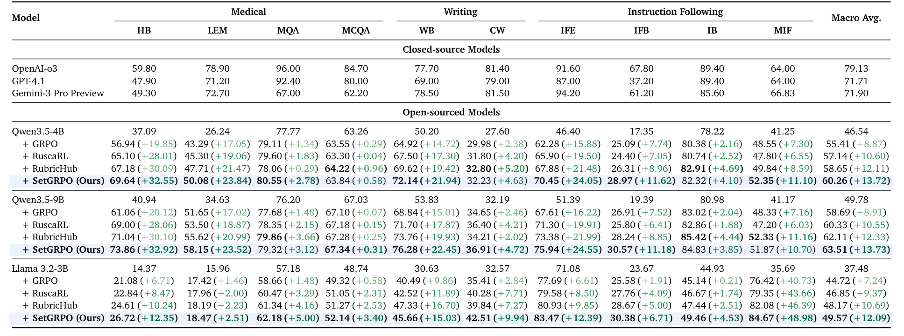
</p>

### Same-backbone comparison

Holding the backbone fixed against RubricHub isolates the effect of the method itself: 57.56 against 56.06 on
Qwen3-4B, and 60.59 against 59.12 on Qwen3-14B. The joint coefficient set and the execution threshold are calibrated
separately for each backbone, so the gain does not come from backbone-specific tuning.

<p align="center">
  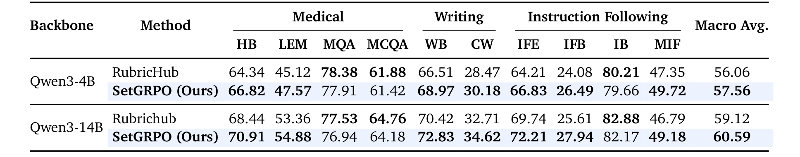
</p>

### Training dynamics

Reward rises steadily and saturates, while policy entropy declines without an abrupt collapse. The accepted-group
ratio stays non-zero after screening, and the mean recovery ratio over accepted groups holds around 76%–80%, so the
retained updates keep contributing to optimization.

<p align="center">
  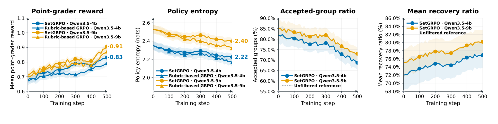
</p>

### Risk calibration

Empirical direction-reversal risk and its one-sided Clopper–Pearson upper bound both decrease as the projection
threshold tightens. At the selected threshold the upper bound stays below the target `β = 0.08`.

<p align="center">
  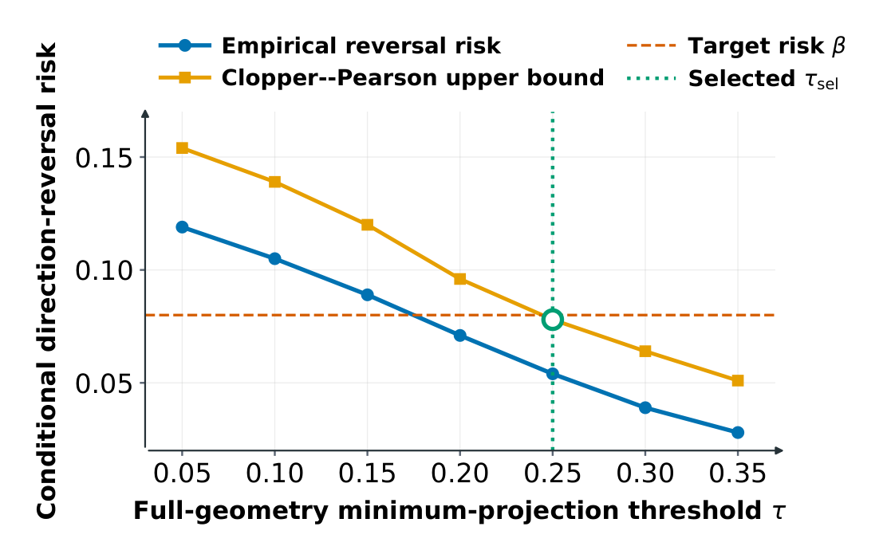
</p>

### Ablation

Every variant trails the full setting on Qwen3.5-4B. A matched random discard, which keeps the same number of groups,
falls furthest behind — the gain comes from geometry-based screening rather than from issuing fewer updates.

<p align="center">
  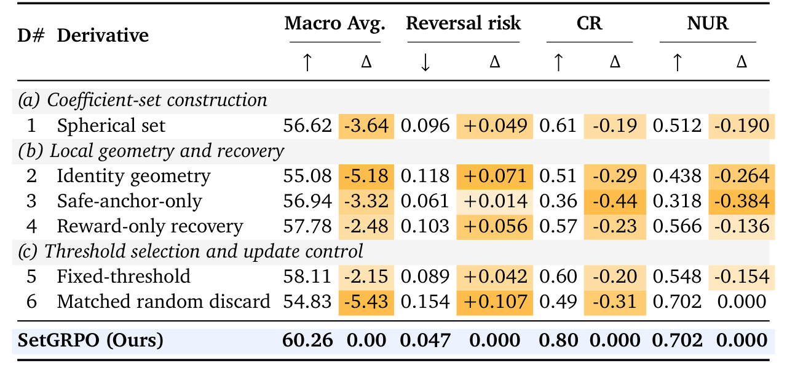
</p>

### Efficiency

The additional cost is a Jacobian pass plus a per-group recovery search. Rollout and grader time are unchanged, and
the overhead buys a 4.75-point macro-average gain over GRPO at the same budget.

<p align="center">
  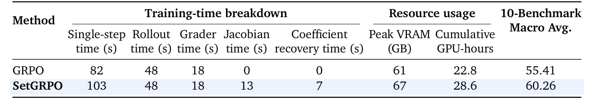
</p>

<p align="left"><a href="#top"><b>⬆ Back to top</b></a></p>

## 📂 Repository Structure

Our codebase is highly modular. Here is a brief overview of the core files:

```
SetGRPO/
├── 📁 setgrpo/                  # Framework-independent numerical core
│   ├── 🎯 calibration.py        # Group normalization, coefficient sets, conformal radii
│   ├── 📐 geometry.py           # Local policy geometry, projected response Jacobians
│   ├── 🧮 jacobian.py           # Optional CountSketch gradient projection (needs PyTorch)
│   ├── 🩹 recovery.py           # Support margins, safe anchors, geometry-guided recovery
│   ├── 🛡️ risk.py              # Selective risk calibration and threshold selection
│   ├── ♻️ online.py            # Framework-neutral online GRPO update construction
│   ├── 🌡️ warmup.py            # Paired-score calibration, frozen artifacts
│   ├── 📜 certificate.py        # Deploy-time certificates
│   ├── 🏋️ training.py          # Minimal tensor-batch adapter
│   ├── 🗂️ data.py              # JSON-friendly certificate row helpers
│   └── ⌨️ cli.py               # setgrpo-calibrate entry point
├── 📁 setgrpo_preflight/        # Startup and pre-training checks
├── 📁 setgrpo_sidecar/          # Policy-Jacobian service
├── 📁 recipe/dapo/              # Paper training entrypoint (Ray + FSDP + Verl)
├── 📁 health_bench/             # Batched reward function used in the paper
├── 📁 eval/                     # External-judge API client
├── 📁 scripts/                  # Grader endpoint checks before a job
├── 📁 examples/                 # Synthetic offline / online walkthroughs
├── 📁 tests/                    # Core unit tests
├── 📁 verl/                     # Vendored Verl runtime
└── 📁 assets/                   # Figures referenced by this README
```
<p align="left"><a href="#top"><b>⬆ Back to top</b></a></p>

## 🚀 Installation

**1. Clone the repository**

```bash
git clone https://github.com/ArcadiaDream/SetGRPO-v2.git
cd SetGRPO
```

**2. Set up the environment**

We recommend Conda to keep the training stack isolated. The numerical core alone runs on plain `pip` with Python 3.10
or newer, so a calibration-only workflow stays installable on a laptop.

```bash
conda create -n setgrpo python=3.10
conda activate setgrpo
```

**3. Install the package**

Pick the extras that match what you need to run:

```bash
pip install -e .                  # core only: NumPy + SciPy
pip install -e '.[training]'      # adds torch, ray, hydra, pyarrow
pip install -e '.[verl]'          # full paper runtime, adds vllm
pip install -e '.[test]'          # pytest, for tests/
```

**4. Check the install**

```bash
setgrpo-calibrate --help
```

The command ships with `--calibration`, `--risk`, `--output`, and the risk parameters `--alpha`, `--beta`, `--gamma`.
`setgrpo-certify` exists as well, and expects an application-specific rollout provider supplied from Python.
<p align="left"><a href="#top"><b>⬆ Back to top</b></a></p>

## 📂 Data Preparation

This repository does not redistribute any dataset. A training run needs three inputs from the caller, and each one
has a fixed place in the recipe.

### Training prompts with rubrics

A parquet file following the Verl RLHF dataset layout. It carries the prompt field consumed by `data.train_files` and
the rubric text read by the batched reward function. The paper trains on the RubricHub training set; arrange your own
copy in the same schema.

### A grading endpoint

Either an OpenAI-compatible external API or a locally served judge. The wrapper reads `STAGE2_API_BASE_URL`,
`STAGE2_API_MODEL`, and `STAGE2_API_KEY` from the environment and stores no credentials.

### A local model checkpoint

Passed as `actor_rollout_ref.model.path`, in the standard Hugging Face layout.

After preparing the three inputs, ensure the folder structure matches the following:

```
SetGRPO/
├── recipe/dapo/
│   ├── config/dapo_trainer.yaml      # setgrpo.* options live here
│   ├── run_setgrpo_rubrichub_online.sh
│   └── run_setgrpo_rubrichub_external_api.sh
└── <your-data>/
    ├── train.parquet                 # prompts + rubrics
    └── <model>/                      # local checkpoint
```
<p align="left"><a href="#top"><b>⬆ Back to top</b></a></p>

## 🏃 Quick Start

### 1. Training the model

Train SetGRPO on your own prompts and checkpoint using the DAPO entrypoint.

```bash
python -m recipe.dapo.main_dapo \
  actor_rollout_ref.model.path=/path/to/model \
  data.train_files=/path/to/train.parquet \
  algorithm.adv_estimator=setgrpo \
  algorithm.setgrpo.online.enabled=true \
  algorithm.setgrpo.online.provider_type=online_certificate \
  custom_reward_function.path=health_bench/scaleai_batch_reward_fn.py \
  custom_reward_function.name=compute_score_batched \
  trainer.n_gpus_per_node=4 trainer.nnodes=1
```

### 2. Run the offline certificate

Two shipped scripts exercise the calibration and recovery APIs on synthetic scores.

```bash
python examples/offline_certificate.py
python examples/online_update.py
```

### 3. Freeze a calibration rule

Freeze the joint coefficient set and the risk-gated threshold into a JSON rule for deployment.

```bash
setgrpo-calibrate --calibration calib.jsonl --risk risk.jsonl --output rule.json
```

(Where `calib.jsonl` and `risk.jsonl` hold paired-score rows, and `--alpha`, `--beta`, `--gamma` set the coverage and
risk targets. The external-API wrapper `recipe/dapo/run_setgrpo_rubrichub_external_api.sh` preflights the grader
endpoint before launching; see [`recipe/dapo/README.md`](recipe/dapo/README.md) for the full runtime requirements.)
<p align="left"><a href="#top"><b>⬆ Back to top</b></a></p>

## 📦 What Is Not Shipped

This repository does not include model weights, private datasets, API keys, checkpoints, or a cluster-specific
launcher. Training requires a caller-provided model, a parquet dataset, and grader credentials.
<p align="left"><a href="#top"><b>⬆ Back to top</b></a></p>

## 🤝 Acknowledgements

This implementation builds on [Verl](https://github.com/volcengine/verl) for the Ray/FSDP training runtime, and on
conformal prediction and conformal risk control for the statistical guarantees. The vendored subset under `verl/` is
redistributed under the Apache License 2.0; see [`verl/NOTICE.md`](verl/NOTICE.md) for upstream attribution.
<p align="left"><a href="#top"><b>⬆ Back to top</b></a></p>

## ✉️ Contact

If you have any questions, feel free to open an [issue](https://github.com/ArcadiaDream/SetGRPO-v2/issues) or reach out
to us at **lizixu.cs@gmail.com** ☺️
<p align="left"><a href="#top"><b>⬆ Back to top</b></a></p>

## 📝 ⭐ Citation

If you find our work or this code useful in your research, please consider leaving a **Star** ⭐ or **Citing** 📝 our
paper 🥰. Your support is our greatest motivation!

```bibtex
@misc{huang2026setgrpo,
  title         = {SetGRPO: Calibrating Grader-Induced Policy Optimization},
  author        = {Huang, Jiale and Li, Zixu and Chen, Zhiwei and Fu, Zhiheng
                   and Bi, Jinhe and Hu, Yupeng},
  year          = {2026},
  eprint        = {2610.36807},
  archivePrefix = {arXiv},
  primaryClass  = {cs.LG},
  url           = {https://arxiv.org/abs/2610.36807}
}
```
<p align="left"><a href="#top"><b>⬆ Back to top</b></a></p>

## 🔗 Related Projects

*Other works from our team:*

<table style="width:100%; border:none; text-align:center; background-color:transparent;">
  <tr style="border:none;">
    <td style="width:33%; border:none; vertical-align:top; padding-top:30px;">
      <br>
      <b>TEMA (ACL'26)</b><br>
      <span style="font-size: 0.9em;">
        <a href="https://arxiv.org/abs/2604.21806" target="_blank">Paper</a> |
        <a href="https://lee-zixu.github.io/TEMA.github.io/" target="_blank">Project</a> |
        <a href="https://github.com/iLearn-Lab/ACL26-TEMA" target="_blank">Code</a>
      </span>
    </td>
    <td style="width:33%; border:none; vertical-align:top; padding-top:30px;">
      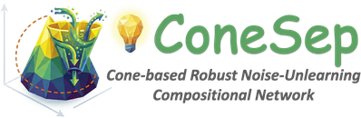<br>
      <b>ConeSep (CVPR'26)</b><br>
      <span style="font-size: 0.9em;">
        <a href="https://arxiv.org/abs/2604.20358" target="_blank">Paper</a> |
        <a href="https://lee-zixu.github.io/ConeSep.github.io/" target="_blank">Project</a> |
        <a href="https://github.com/iLearn-Lab/CVPR26-ConeSep" target="_blank">Code</a>
      </span>
    </td>
    <td style="width:33%; border:none; vertical-align:top; padding-top:30px;">
      <br>
      <b>Air-Know (CVPR'26)</b><br>
      <span style="font-size: 0.9em;">
        <a href="https://arxiv.org/abs/2604.19386" target="_blank">Paper</a> |
        <a href="https://zhihfu.github.io/Air-Know.github.io/" target="_blank">Project</a> |
        <a href="https://github.com/ZhihFu/Air-Know" target="_blank">Code</a>
      </span>
    </td>
  </tr>
  <tr style="border:none;">
    <td style="width:33%; border:none; vertical-align:top; padding-top:30px;">
      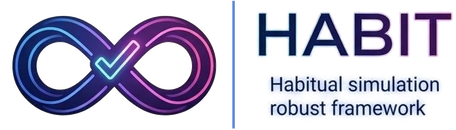<br>
      <b>HABIT (AAAI'26)</b><br>
      <span style="font-size: 0.9em;">
        <a href="https://ojs.aaai.org/index.php/AAAI/article/view/37608" target="_blank">Paper</a> |
        <a href="https://lee-zixu.github.io/HABIT.github.io/" target="_blank">Project</a> |
        <a href="https://github.com/iLearn-Lab/AAAI26-HABIT" target="_blank">Code</a>
      </span>
    </td>
    <td style="width:33%; border:none; vertical-align:top; padding-top:30px;">
      <br>
      <b>ReTrack (AAAI'26)</b><br>
      <span style="font-size: 0.9em;">
        <a href="https://ojs.aaai.org/index.php/AAAI/article/view/39507" target="_blank">Paper</a> |
        <a href="https://lee-zixu.github.io/ReTrack.github.io/" target="_blank">Project</a> |
        <a href="https://github.com/iLearn-Lab/AAAI26-ReTrack" target="_blank">Code</a>
      </span>
    </td>
    <td style="width:33%; border:none; vertical-align:top; padding-top:30px;">
      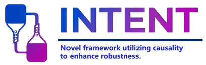<br>
      <b>INTENT (AAAI'26)</b><br>
      <span style="font-size: 0.9em;">
        <a href="https://ojs.aaai.org/index.php/AAAI/article/view/39181" target="_blank">Paper</a> |
        <a href="https://zivchen-ty.github.io/INTENT.github.io/" target="_blank">Project</a> |
        <a href="https://github.com/ZivChen-Ty/INTENT" target="_blank">Code</a>
      </span>
    </td>
  </tr>
  <tr style="border:none;">
    <td style="width:33%; border:none; vertical-align:top; padding-top:30px;">
      <br>
      <b>HUD (ACM MM'25)</b><br>
      <span style="font-size: 0.9em;">
        <a href="https://dl.acm.org/doi/10.1145/3746027.3755445" target="_blank">Paper</a> |
        <a href="https://zivchen-ty.github.io/HUD.github.io/" target="_blank">Project</a> |
        <a href="https://github.com/ZivChen-Ty/HUD" target="_blank">Code</a>
      </span>
    </td>
    <td style="width:33%; border:none; vertical-align:top; padding-top:30px;">
      <br>
      <b>OFFSET (ACM MM'25)</b><br>
      <span style="font-size: 0.9em;">
        <a href="https://dl.acm.org/doi/10.1145/3746027.3755366" target="_blank">Paper</a> |
        <a href="https://zivchen-ty.github.io/OFFSET.github.io/" target="_blank">Project</a> |
        <a href="https://github.com/ZivChen-Ty/OFFSET" target="_blank">Code</a>
      </span>
    </td>
    <td style="width:33%; border:none; vertical-align:top; padding-top:30px;">
      <br>
      <b>ENCODER (AAAI'25)</b><br>
      <span style="font-size: 0.9em;">
        <a href="https://ojs.aaai.org/index.php/AAAI/article/view/32541" target="_blank">Paper</a> |
        <a href="https://sdu-l.github.io/ENCODER.github.io/" target="_blank">Project</a> |
        <a href="https://github.com/Lee-zixu/ENCODER" target="_blank">Code</a>
      </span>
    </td>
  </tr>
</table>
<p align="left"><a href="#top"><b>⬆ Back to top</b></a></p>

## 🫡 Support & Contributing

We welcome all forms of contributions! If you have any questions, ideas, or find a bug, please feel free to:

- Open an [Issue](https://github.com/ArcadiaDream/SetGRPO-v2/issues) for discussions or bug reports.
- Submit a [Pull Request](https://github.com/ArcadiaDream/SetGRPO-v2/pulls) to improve the codebase.
<p align="left"><a href="#top"><b>⬆ Back to top</b></a></p>

## 📄 License

Apache-2.0. See [LICENSE](LICENSE).
<p align="left"><a href="#top"><b>⬆ Back to top</b></a></p>

<p align="center">
  
</p>

<p align="center">
  <a href="https://github.com/ArcadiaDream/SetGRPO-v2"></a>
  <a href="https://github.com/ArcadiaDream/SetGRPO-v2/issues"></a>
  <a href="https://github.com/ArcadiaDream/SetGRPO-v2/pulls"></a>
</p>

<p align="center">
  <a href="https://github.com/ArcadiaDream/SetGRPO-v2"></a>
</p>

